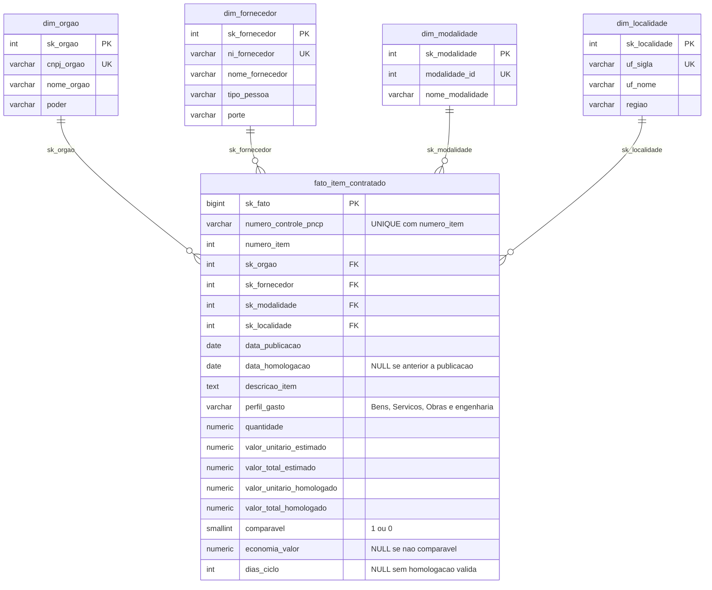
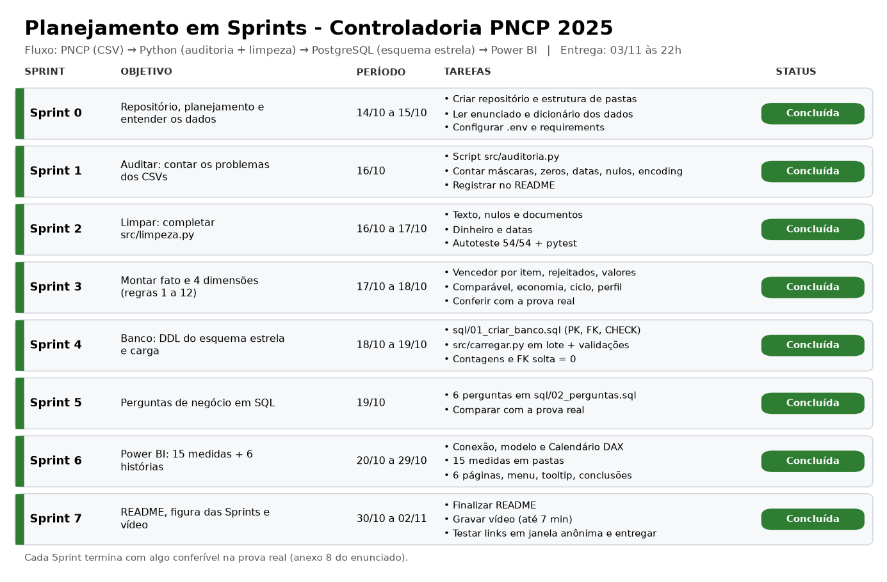

# Controladoria PNCP 2025: esteira analítica de compras públicas federais

> Projeto Avaliativo do Módulo 2 · Análise de Dados com Python – PostgreSQL [T1]
> Autor(a): William Filipe Kahl · Vídeo (Review de Sprint): https://drive.google.com/drive/folders/12j-0ra5aT9lMtWz055b8B-VQ17ZXeGWe?usp=sharing

**PNCP (CSV bruto) → Python (auditoria + limpeza) → PostgreSQL (esquema estrela) → Power BI (dashboard executivo)**

## 1. Contexto do problema

A Controladoria precisa de clareza sobre as compras federais de 2025: há indícios de **sobrepreço**, **concentração** de contratos em poucos fornecedores,
**morosidade** entre edital e homologação e **baixa competição** em certas modalidades. Os sistemas de origem não validam os dados na entrada, então os
arquivos do PNCP chegam com CNPJ mascarado ou sem zero à esquerda, dinheiro em texto (`R$ 1.234,56`, `(1.500,00)`), vários formatos de data,
acentos quebrados e nulos disfarçados.

Este projeto transforma esse material em um ambiente **confiável, auditável e executivo** e responde a 6 perguntas de negócio (seção 7).

Base: 3 CSVs do PNCP já extraídos (`data/raw/`), 12 meses de 2025: `compras.csv` (2.042 contratações), `itens.csv` (7.077 itens) e `resultados.csv` (15.896 fornecedores classificados).

## 2. Estrutura do repositório

```
.
├── data/
│   ├── raw/                  # CSVs brutos do PNCP (entrada, não editar)
│   └── processed/            # tabelas limpas geradas pelo pipeline (ignorado no Git)
├── src/
│   ├── config.py             # caminhos e credenciais (.env)
│   ├── banco.py              # conexão, DROP/CREATE DATABASE, carga em lote
│   ├── auditoria.py          # Sprint 1: conta os problemas dos dados brutos
│   ├── limpeza.py            # Sprint 2: funções de limpeza (autoteste incluso)
│   ├── montar_tabelas.py     # Sprint 3: regras de negócio, fato e 4 dimensões
│   └── carregar.py           # Sprint 4: validação + carga no PostgreSQL
├── sql/
│   ├── 01_criar_banco.sql    # DDL do esquema estrela (PK, FK, UNIQUE, CHECK)
│   └── 02_perguntas.sql      # as 6 perguntas de negócio
├── powerbi/                  # .pbix, fórmulas DAX e roteiro do dashboard
├── tests/                    # pytest: limpeza e regras de negócio
├── reports/auditoria.md      # saída de src/auditoria.py
├── docs/                     # figura das Sprints e script que a gera
├── requirements.txt · .env.example · .gitignore
```

## 3. Como reproduzir do zero

Pré-requisitos: Python 3.10+, PostgreSQL 14+ rodando e Power BI Desktop (só para o dashboard).

```bash
# 1) ambiente
python -m venv .venv
source .venv/bin/activate            # Windows: .venv\Scripts\activate
pip install -r requirements.txt

# 2) credenciais do banco (o .env nunca vai para o Git)
cp .env.example .env                 # edite PG_PASSWORD (e host/porta, se for o caso)

# 3) pipeline, na ordem
python -m src.auditoria              # (opcional) gera reports/auditoria.md
python -m src.limpeza                # autoteste: deve terminar com "54 de 54 exemplos certos"
python -m src.montar_tabelas         # gera data/processed/*.csv e imprime a conferência (prova real)
python -m src.carregar               # recria o banco, cria as tabelas, carrega e confere

# 4) testes
python -m pytest -q                  # 65 testes

# 5) perguntas: abra sql/02_perguntas.sql no pgAdmin (ou: psql -d pncp_controladoria -f sql/02_perguntas.sql)
```

`python -m src.carregar` **apaga e recria** o banco definido em `PG_DATABASE`: use um nome só deste projeto.
Dashboard: abra `powerbi/controladoria_pncp.pbix` (ou monte conforme `powerbi/roteiro_dashboard.md`) e aponte para `localhost` / `pncp_controladoria`.

## 4. Decisões técnicas e por quê

| Decisão | Motivo |
| --- | --- |
| Ler os CSVs com `dtype=str` | CNPJ lido como número perde o zero da esquerda; nada pode virar `NaN` sozinho antes da limpeza |
| Uma função de limpeza por problema, com autoteste de 54 exemplos | Cada regra é testável isoladamente e a limpeza fica explicável linha a linha |
| Regra do separador: ponto ou vírgula **sozinho** é decimal | Ler `746.815` como milhar faria o volume homologado explodir (R$ 31 bi em vez de R$ 8 bi) |
| Descartar cancelados **antes** de escolher o 1º colocado | Se o 1º estiver cancelado, o 2º assume; a ordem inversa perderia ~60 itens |
| Desempate pelo menor `sequencial_resultado` (lido como número) | Em Credenciamento todos vêm com ordem vazia; como texto, `10` viria antes de `2` |
| Itens sem comparação ficam na fato, mas fora da economia | Credenciamento tem teto global como estimado; razões fora de 0,1 a 10 distorcem (75% em vez de 14%) |
| Economia % = soma ÷ soma, nunca média de percentuais | Média de percentuais dá o mesmo peso a um item de R$ 10 e a um de R$ 1 bi |
| `economia_valor` **vazia (NULL)** nos não comparáveis | Segue a seção 4.3. "Sem economia calculável" é diferente de "economia zero"; as somas ignoram o vazio |
| Esquema estrela com chaves substitutas (`sk_`) e chave natural `UNIQUE` | Dimensões estáveis mesmo que o CNPJ ou o nome mude de grafia; a carga é rastreável ao PNCP |
| Linha "Não informado" (`sk = -1`) em cada dimensão | Garante que dado futuro sem dimensão não quebre a integridade. Hoje nenhuma FK cai nela |
| `NUMERIC(18,2)` / `(18,4)`, nunca `FLOAT` | Somas de dinheiro sem erro de ponto flutuante |
| `CHECK` no banco (quantidade > 0, valores ≥ 0, perfil, cronologia, ciclo) | O banco é a segunda barreira depois do Python |
| Validação prévia + carga em lote (`execute_values`) + rollback | Falha cedo e com mensagem clara; 1 comando por tabela em vez de milhares |

## 5. Dicionário das inconsistências tratadas

Contagens geradas por `python -m src.auditoria` (detalhe completo em [`reports/auditoria.md`](reports/auditoria.md)).

| # | Desafio | O que foi encontrado | Como é tratado |
| --- | --- | --- | --- |
| 1 | **CNPJ/CPF** | `compras.cnpj_orgao`: 176 com máscara, 77 sem o zero da esquerda. `resultados.ni_fornecedor`: 1.633 com máscara, 194 PJ e 159 PF com zero perdido, 21 estrangeiros (PE) | `limpar_documento`: só dígitos + `zfill(14 ou 11)` conforme o tipo; PE fica como veio; dígitos demais → `None` |
| 2 | **Dinheiro e decimais** | Em `valor_unitario_homologado` (15.896 linhas): 2.650 com `R$`, 532 com milhar e decimal juntos, 432 com vírgula decimal; 704 com espaço invisível. Padrões parecidos em quantidade e no estimado | `converter_numero`: remove `R$` e espaços, decide o decimal pela regra do enunciado, negativo por `( )` ou `-`; zero é valor, não nulo |
| 3 | **Datas** | 6 formatos na mesma coluna (ISO, `DD/MM/AAAA`, `DD-MM-AAAA`, `DD.MM.AAAA`, `AAAA/MM/DD`, `AAAAMMDD`), com ou sem hora. 234 linhas de resultado com `data_resultado` anterior à publicação | `converter_data`: tenta cada formato nos 10 primeiros caracteres, só vale 2000–2030. Homologação anterior à publicação vira `NULL` (item fica na fato, sem ciclo) |
| 4 | **Nulos disfarçados** | `N/A`, `NULL`, `-`, `0`, `SEM INFORMAÇÃO`, `NÃO SE APLICA`…; `resultados.porte` tem 4.893 casos | `eh_nulo` / `limpar_texto` → `None`. O `0` só é nulo em texto (`zero_eh_nulo=False` nos números) |
| 5 | **Encoding e texto** | Acento quebrado (`Aquisição`): 116 em `itens.descricao`, 43 em `objeto_compra`, 14 em `nome_unidade`, 1 em fornecedor. Espaços repetidos em centenas de linhas. Caracteres invisíveis (largura zero) | `consertar_acento` (Latin-1 → UTF-8), `remover_invisiveis`, `tirar_espacos`; `padronizar_nome` coloca em maiúsculas e padroniza hífen |

Outras observações sobre os dados: não há `numero_controle_pncp` repetido em compras; 62 resultados cancelados; 11.976 resultados com `ordem_classificacao_srp` vazia (valem 1);
852 itens sem resultado; `ano_compra` pode ser anterior a 2025 (o que vale é `data_publicacao`).

### Itens rejeitados (regra 4): 99 de 6.225 itens com resultado

Primeiro motivo que ocorre, na ordem da regra: valor total estimado < R$ 1 (59), valor unitário estimado ausente ou ≤ 0 (23),
homologado > 1.000× o estimado (7), valor unitário homologado ausente ou ≤ 0 (6), valor acima de R$ 1 trilhão (3), quantidade vazia ou ≤ 0 (1), orçamento sigiloso (0 como primeiro motivo: os sigilosos já caem antes por não terem estimado utilizável).
Os 852 itens sem resultado **não** contam como rejeitados.

### Perfil do gasto (regra 8)

Palavras de obra, procuradas como palavra inteira (`\b`) na descrição do item e no `objeto_compra`: **obra(s), construção, reforma, engenharia**.
Achou → *Obras e engenharia* (prioridade); senão `Material` → *Bens* e `Serviço` → *Serviços*. Sem o `\b`, "cobrança" e "dobradiça" virariam obra.

## 6. Modelagem dimensional (esquema estrela)



O tempo é a tabela `Calendario`, criada em DAX no Power BI e ligada a `data_publicacao` (ativa) e `data_homologacao` (inativa, via `USERELATIONSHIP`).
Cada dimensão tem uma linha `sk = -1` "Não informado" (fora das contagens esperadas).

**Garantias de integridade:** PK em toda tabela; `FOREIGN KEY` da fato para as 4 dimensões; `UNIQUE (numero_controle_pncp, numero_item)` (grão);
`UNIQUE` nas chaves naturais; `CHECK` de quantidade, valores, flag `comparavel`, perfil, cronologia e coerência `data_homologacao` ↔ `dias_ciclo`.

## 7. Resultados: as 6 perguntas (`sql/02_perguntas.sql`)

Todos os números abaixo foram conferidos contra o banco carregado e batem com a prova real do enunciado.

| # | Pergunta | Resposta |
| --- | --- | --- |
| 1 | Economia global | Estimado comparável R$ 6,87 bi; homologado R$ 5,87 bi; **economia R$ 992.861.686,95 = 14,46%**. 5.457 itens comparáveis (89,08%); 27 com sobrepreço |
| 2 | Concentração de fornecedores | Os 10 maiores concentram **41,43%** do volume (R$ 3,33 bi de R$ 8,04 bi) entre 2.652 fornecedores. O 1º (NOW SEGUROS S.A.) é **um único item de R$ 1,06 bi = 13,18%** |
| 3 | Modalidades | Maior deságio: **Pregão Eletrônico (24,02%)**. Maior volume: **Concorrência Eletrônica (58,43%)**. Credenciamento movimenta 26,62% e fica sem economia % (nenhum item comparável) |
| 4 | Ciclo por órgão | Ciclo médio **48,1 dias**, máximo **611**; 5.896 itens com ciclo e 230 sem. 142 órgãos com 5+ itens com ciclo; o mais lento é a UFCG (266 dias) |
| 5 | Regional | **Centro-Oeste 44,25%** do volume (DF sozinho 38,98%). Maior desconto: **Norte (21,43%)**; menor: Sul (7,96%) |
| 6 | Perfil do gasto | **Obras e engenharia 60,8%** (967 itens) · **Serviços 36,6%** (1.849) · **Bens 2,6%** (3.310) |

Observações para a Controladoria: (a) o fornecedor nº 1 é um único contrato; vale auditar esse item, porque ele sozinho move a concentração;
(b) o desconto alto de Pregão Eletrônico convive com o grande volume em Concorrência: a modalidade que mais economiza não é a que mais gasta.

## 8. Dashboard (Power BI)

Fórmulas do Calendário e das 15 medidas (com `VAR/RETURN`, `CALCULATE`, `DIVIDE`, `TOPN`, `RANKX`, `USERELATIONSHIP`): [`powerbi/medidas_dax.md`](powerbi/medidas_dax.md).
Páginas, menu retrátil com indicadores, tooltip e princípios de design: [`powerbi/roteiro_dashboard.md`](powerbi/roteiro_dashboard.md).
Cada página segue: pergunta (título) → números → conclusão.

## 9. Técnicas e tecnologias

Python 3.10+ · pandas · psycopg2 (`execute_values`, carga em lote) · PostgreSQL · SQL (CTE, window functions, `FILTER`, `NULLIF`) · pytest · Power BI / DAX · Git e GitHub · Mermaid (diagrama).
Técnicas: auditoria de qualidade de dados, limpeza com regex e parsing multi-formato, modelagem dimensional (Kimball), chaves substitutas, constraints, ETL em lote com validação.

## 10. Planejamento em Sprints



## 11. Discordâncias e limites (anotados, sem alterar as regras)

- Ordem de colocação vazia vale 1 e o desempate é pelo menor sequencial; em Credenciamento isso escolhe um fornecedor arbitrário entre vários classificados: o volume do item é preservado, mas a identidade do "vencedor" é uma convenção.
- A janela de razão 0,1 a 10 para "comparável" é um corte de qualidade; itens com razão fora dela ficam no volume mas não na economia (669 itens, 10,9% da fato, dos quais 601 são de Credenciamento).
- Perfil do gasto depende das 4 palavras escolhidas: com outras palavras os percentuais mudam um pouco.

## 12. Melhorias futuras

- Agendar o pipeline (Airflow ou cron) e baixar o PNCP direto da API oficial, de forma incremental.
- Detecção de outliers com regra estatística (ex.: mediana por descrição de item) em vez de cortes fixos.
- Dimensão de item com catálogo (CATMAT/CATSER) para comparar preços do mesmo produto entre órgãos.
- Separar serviços continuados de eventuais; classificar o perfil por modelo de texto em vez de palavras-chave.
- Testes de dados no banco (Great Expectations) e CI no GitHub Actions rodando `pytest`.
- Row-level security no Power BI por poder/órgão.
